# 🖼️ Well-Architected AWS Serverless Image Processing Pipeline


> 🌟 **Note:** This project serves as my capstone portfolio for the **AWS Certified Solutions Architect – Associate (SAA-C03)** certification, demonstrating the practical application of AWS Well-Architected principles.

## 📖 Overview
This repository contains the architectural design, application code, and Infrastructure as Code (IaC) for a highly scalable, fully serverless image processing pipeline on AWS.

The system securely accepts image uploads using pre-signed URLs (protected by API Keys and Usage Plans), decouples ingestion from processing using Amazon SQS, and orchestrates a multi-step workflow (validation, resizing, watermarking, and metadata extraction) using AWS Step Functions. Final images are delivered globally with low latency via Amazon CloudFront, while metadata is stored in DynamoDB.

## 🏗️ Architecture Diagram


## 🔄 Architectural Flow
1. **Upload & Initiation:** The client requests a pre-signed URL via API Gateway (secured with API Keys and throttling). A Lambda function generates the URL, allowing the client to upload the image directly to the **S3 Ingest Bucket** (bypassing API Gateway payload limits).
2. **Ingest & Buffer:** The S3 upload (filtered to the `uploads/` prefix to prevent infinite processing loops) triggers an event notification that sends a message to an **Amazon SQS** queue. Failed messages are routed to a Dead Letter Queue (DLQ) after 5 failed attempts.
3. **Orchestration & Idempotency:** A **Poller Lambda** reads the SQS message and uses a DynamoDB conditional write to acquire an atomic lock based on the S3 object eTag and sequencer (to handle distinct uploads of identical files). It records the active Step Functions Execution ARN. If a duplicate event arrives, it queries Step Functions for the current execution status. If the execution failed, it atomically updates the DynamoDB lock to a new retry ARN and starts a new execution. Stale locks with missing executions are safely cleaned up using conditional deletes.
4. **Processing Workflow:** Step Functions orchestrates a 5-step microservice pipeline using **AWS Lambda** (equipped with `Pillow` via Lambda Layers):
   * `Validate` → `Resize` → `Watermark` → `Extract Metadata` → `Store`.
   * The `Validate` step uses `ContentLength` checks and deep image inspection (`Image.verify()`) to prevent oversized files, decompression bombs, and invalid formats. 
   * The state machine is configured to retry only transient AWS service failures (e.g., timeouts, service exceptions) and fails immediately on permanent validation errors.
5. **Storage & Delivery:** Processed images are saved to the **S3 Destination Bucket** (standardized to `.jpg`), while metadata is written to **Amazon DynamoDB**. Users retrieve images globally via **Amazon CloudFront** (secured with Origin Access Control).
6. **Observability & Alerting:** The system uses **AWS X-Ray** for distributed tracing across the entire pipeline. **Amazon CloudWatch** monitors for DLQ depth, failed Step Functions executions, and individual Lambda execution errors for the Poller, Validate, Resize, Watermark, and Store functions. **Amazon SNS** sends immediate email alerts if a workflow fails, a message reaches the DLQ, or a Lambda crashes.

## 📂 Repository Structure
This project follows a **Microservice Architecture** to ensure isolated dependencies and least-privilege IAM roles.

```text
├── .github/                # CI/CD pipeline (Validates IaC and runs unit tests)
├── docs/                   # Architecture diagram and detailed design decisions
├── infrastructure/         # Infrastructure as Code (AWS SAM template)
├── layers/                 # Lambda Layers (Pillow dependencies)
├── src/                    # Application code
│   ├── generate_url/       # Pre-signed URL generator microservice
│   ├── poller/             # SQS to Step Functions trigger with DynamoDB locking
│   └── steps/              # Step Functions processing microservices
│       ├── validate/       # Checks file size, format, and pixel limits
│       ├── resize/         # Resizes image (uses Pillow layer)
│       ├── watermark/      # Applies watermark and standardizes to .jpg
│       ├── extract_metadata/ # Extracts image properties
│       └── store/          # Saves final image to S3 and DynamoDB
├── statemachine/           # Step Functions Amazon States Language (ASL) definition
├── tests/                  # Automated unit tests for all Lambda handlers
└── README.md
```

## 🚀 CI/CD Pipeline
This repository uses **GitHub Actions** to ensure code quality. On every push to the `main` branch, the pipeline automatically:
1. Installs all Python dependencies across the microservices and layers.
2. Runs comprehensive automated unit tests for the Poller and all processing Lambdas (and explicitly fails the build if zero tests are discovered using `pipefail` and stream capture).
3. Validates the Infrastructure as Code (IaC) template syntax using the AWS SAM CLI (`sam validate --lint`).
4. Runs `sam build` to verify the Lambda packages and Pillow layers compile successfully.
*(Note: Actual AWS deployment is intentionally bypassed in this demo to avoid requiring AWS credentials and potential charges).*

## 🔒 Well-Architected Framework Alignment
*   **Operational Excellence:** Infrastructure as Code (IaC), automated CI/CD validation, comprehensive unit testing, X-Ray tracing, and granular CloudWatch alarms.
*   **Security:** Least Privilege IAM policies, API Keys with Usage Plans (for throttling/usage), S3 Block Public Access, AES-256 encryption, CloudFront OAC, and deep image verification.
*   **Reliability:** SQS buffering with partial batch failure handling, atomic DynamoDB idempotency locks, Step Functions exponential backoff for transient failures, Dead Letter Queues (DLQ), and SNS failure alerts.
*   **Performance:** Pre-signed URLs offload ingestion directly to S3, and CloudFront caches processed images at the edge.
*   **Cost Optimization:** Automated S3 Lifecycle transitions to Glacier after 30 days, and serverless pay-per-use pricing.
*   **Sustainability:** Serverless compute (Lambda) scales to zero when idle, minimizing wasted energy, and CloudFront edge caching reduces the energy required to transmit data over long distances.

## 🧠 Design Decisions
*   **Dual DynamoDB Records:** The Poller Lambda maintains an **idempotency lock** record keyed by an MD5 hash of the bucket, key, and sequencer. Separately, the `Store` Lambda writes a **metadata completion** record keyed by the original image key (`original_key`). This separation allows the pipeline to track execution state independently of the final output, preventing duplicate processing while maintaining a clean data model for downstream consumers.
*   **S3 Versioning & Sequencers:** To support processing every distinct upload of a file, the idempotency key uses the S3 `sequencer` field when available, falling back to the `eTag`. This ensures that uploading the same image content to the same key multiple times will trigger the pipeline correctly, rather than being treated as a duplicate by the ETag alone.

---
**License:** This project is licensed under the Apache License 2.0 - see the [LICENSE](LICENSE) file for details.
